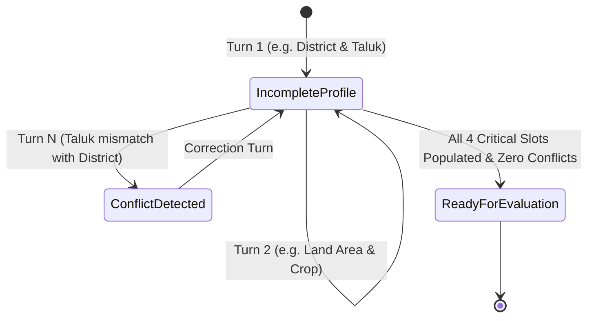

# Milestone M2 — Agricultural Understanding & Normalization Subsystem

## 1. Overview

Milestone M2 implements a robust, deterministic agricultural understanding and normalization subsystem that converts spoken Kannada and code-mixed farmer utterances into canonical, validated, structured agricultural facts:
1. **Phase 0 (Hardening):** Bounded audio duration verification, HTTP client pooling, ephemeral audio ownership scoping, and multi-dialect ASR benchmark expansion.
2. **M2.1 (Agricultural Vocabulary):** Versioned Kannada agricultural datasets (`2026.10.1`) covering crops, irrigation, seasons, equipment, soil amendments, and assistance categories with greedy longest-span matching and Unicode word boundary isolation.
3. **M2.2 (Location Normalization):** Complete canonical Karnataka geographic dataset covering all 31 districts and their notified taluks, regional alias resolution, parentage validation, and anti-hallucination rejection of non-existent places.
4. **M2.3 (Land Measurement Normalization):** Exact `Decimal` arithmetic for acre/gunta/hectare conversions, colloquial Kannada fraction parsing ("ಒಂದೂವರೆ", "ಎರಡೂವರೆ", "ಮೂರೂವರೆ", "ಮುಕ್ಕಾಲು"), composite measurements ("X ಎಕರೆ Y ಗುಂಟೆ"), and ambiguity handling.
5. **M2.4 (Ownership & Assertion Handling):** Land tenure taxonomy (`OWNER`, `CO_OWNER`, `LEASED`, `TENANT_OR_CULTIVATOR`, `UNKNOWN`) and strict assertion provenance (`USER_STATED`, `USER_CONFIRMED`, `SYSTEM_DERIVED`). Non-negotiable invariant: crop cultivation activity never implies legal land ownership, and user statements are never labeled government-verified.
6. **M2.5 (Correction Handling):** Natural Kannada negation parsing ("ಅಲ್ಲ", "ತಪ್ಪು", "ಬದಲಾಗಿ", "ಇಲ್ಲ"), surgical slot replacement, and immutable audit logging (`SlotAuditRecord`).
7. **M2.6 (Agricultural Profile Integration):** Multi-turn profile assembler (`AgriculturalProfileAssembler`) with critical slot tracking, geographic conflict detection, and zero scheme-eligibility calculation.

---

## 2. Phase 0 Baseline Hardening

Building upon Milestone M1, the following hardening steps were applied prior to M2 subsystem implementation:
- **Audio Duration Bounds:** Enforced minimum duration (`0.2s`) and verified decoded duration in both [`app/core/audio/validator.py`](../app/core/audio/validator.py) and [`app/core/audio/normalizer.py`](../app/core/audio/normalizer.py).
- **HTTP Client Lifecycle:** ASR (`IndicConformerAdapter`) and TTS (`IndicTTSAdapter`) accept external lifecycle-managed `httpx.AsyncClient` instances for connection pooling and graceful teardown.
- **Ephemeral Audio Scoping:** Added caller ownership scoping (`owner_id`) and TTL-based audit purging in [`app/core/tts/storage.py`](../app/core/tts/storage.py).
- **Regional ASR Evaluation Set:** Expanded ASR evaluation benchmark in [`tests/unit/test_asr_evaluation.py`](../tests/unit/test_asr_evaluation.py) to cover North, South, Kalyana, and Coastal Karnataka dialect zones.

---

## 3. M2.1 Agricultural Vocabulary

- **Dataset Version:** `2026.10.1`
- **Location:** [`app/core/normalization/vocabulary.py`](../app/core/normalization/vocabulary.py)

### Supported Categories & Canonical Identifiers
- **Crops (`CROP`):** `SORGHUM` (ಜೋಳ), `FINGER_MILLET` (ರಾಗಿ), `PIGEON_PEA` (ತೊಗರಿ), `PADDY` (ಭತ್ತ), `COTTON` (ಹತ್ತಿ), `SUGARCANE` (ಕಬ್ಬು), `GROUNDNUT` (ಕಡಲೆಕಾಯಿ), `MAIZE` (ಮೆಕ್ಕೆಜೋಳ), `BENGAL_GRAM` (ಕಡಲೆ), `GREEN_GRAM` (ಹೆಸರು), `SOYBEAN` (ಸೋಯಾಬೀನ್), `ONION` (ಈರುಳ್ಳಿ), `TOMATO` (ಟೊಮೇಟೊ), `CHILLI` (ಮೆಣಸಿನಕಾಯಿ), `ARECANUT` (ಅಡಿಕೆ), `POMEGRANATE` (ದಾಳಿಂಬೆ), `SUNFLOWER` (ಸೂರ್ಯಕಾಂತಿ).
- **Irrigation Types (`IRRIGATION`):** `DRIP` (ಹನಿ ನೀರಾವರಿ), `SPRINKLER` (ತುಂತುರು ನೀರಾವರಿ), `BOREWELL` (ಕೊಳವೆ ಬಾವಿ), `OPEN_WELL` (ತೆರೆದ ಬಾವಿ), `CANAL` (ಕಾಲುವೆ), `RAINFED` (ಮಳೆ ಆಶ್ರಿತ / ಒಣಬೇಸಾಯ), `LIFT` (ಏತ ನೀರಾವರಿ), `TANK` (ಕೆರೆ ನೀರು).
- **Agricultural Seasons (`SEASON`):** `KHARIF` (ಮುಂಗಾರು), `RABI` (ಹಿಂಗಾರು), `SUMMER` (ಬೇಸಿಗೆ).
- **Equipment (`EQUIPMENT`):** `TRACTOR` (ಟ್ರಾಕ್ಟರ್), `POWER_TILLER` (ಪವರ್ ಟಿಲ್ಲರ್), `HARVESTER` (ಕಟಾವು ಯಂತ್ರ), `SPRAYER` (ಸ್ಪ್ರೇಯರ್), `ROTAVATOR` (ರೊಟಾವೇಟರ್), `THRESHER` (ಒಕ್ಕಣೆ ಯಂತ್ರ).
- **Soil Improvements (`SOIL_IMPROVEMENT`):** `FARM_YARD_MANURE` (ಕೊಟ್ಟಿಗೆ ಗೊಬ್ಬರ), `VERMICOMPOST` (ಎರೆಹುಳು ಗೊಬ್ಬರ), `GREEN_MANURE` (ಹಸಿರೆಲೆ ಗೊಬ್ಬರ), `GYPSUM` (ಜಿಪ್ಸಮ್), `LIME` (ಸುಣ್ಣ), `BIO_FERTILIZER` (ಜೈವಿಕ ಗೊಬ್ಬರ).
- **Assistance Categories (`ASSISTANCE_NEED`):** `SUBSIDY` (ಸಹಾಯಧನ / ಸಬ್ಸಿಡಿ), `LOAN` (ಸಾಲ), `INSURANCE` (ಬೆಳೆ ವಿಮೆ), `DROUGHT_RELIEF` (ಬರ ಪರಿಹಾರ), `FLOOD_RELIEF` (ನೆರೆ ಪರಿಹಾರ), `SOIL_TESTING` (ಮಣ್ಣು ಪರೀಕ್ಷೆ), `EQUIPMENT_SUBSIDY` (ಯಂತ್ರೋಪಕರಣ ಸಬ್ಸಿಡಿ), `MARKET_PRICE` (ಮಾರುಕಟ್ಟೆ ಬೆಲೆ).

### Matching Engine Invariants
- **No Global String Replacement:** Transcripts are never modified or rewritten globally.
- **Greedy Longest-Span Matching:** Aliases are sorted by character length descending. When a multi-word alias matches a span (e.g. `ಕೊಳವೆ ಬಾವಿ`), shorter sub-aliases (e.g. `ಬಾವಿ`) within the same span are suppressed.
- **Unicode Word Boundaries:** Standard Python `\b` fails on non-ASCII Indic scripts. The engine uses Unicode lookaround boundaries:
  $$(?<![\text{\w\u0C80-\u0CFF}]) \text{alias} (?![\text{\w\u0C80-\u0CFF}])$$

---

## 4. M2.2 Location Normalization

- **Dataset Version:** `2026.10.1`
- **Location:** [`app/core/normalization/location.py`](../app/core/normalization/location.py)

### Scope
Covers all **31 officially notified districts** of Karnataka (including Vijayanagara) and all subordinate administrative taluks.

### Features
1. **Historical & Anglicized Alias Resolution:**
   - Belgaum $\rightarrow$ `BELAGAVI` (ಬೆಳಗಾವಿ)
   - Gulbarga $\rightarrow$ `KALABURAGI` (ಕಲಬುರಗಿ)
   - Bijapur $\rightarrow$ `VIJAYAPURA` (ವಿಜಯಪುರ)
   - Mysore $\rightarrow$ `MYSURU` (ಮೈಸೂರು)
   - Bellary $\rightarrow$ `BALLARI` (ಬಳ್ಳಾರಿ)
   - Shimoga $\rightarrow$ `SHIVAMOGGA` (ಶಿವಮೊಗ್ಗ)
2. **Context Disambiguation:**
   Distinguishes district vs taluk when they share identical names (e.g., Belagavi District vs Belagavi Taluk):
   - Text preceding/following `ಜಿಲ್ಲೆ` / `district` $\rightarrow$ prioritize District.
   - Text preceding/following `ತಾಲೂಕು` / `taluk` $\rightarrow$ prioritize Taluk.
3. **Hierarchical Parentage Validation:**
   `validate_taluk_in_district(taluk_id, district_id)` verifies administrative subordination. For example, `ATHANI` in `BELAGAVI` returns `True`, whereas `ATHANI` in `MANDYA` returns `False` and triggers a geographic conflict.
4. **Anti-Hallucination Guardrail:**
   Unrecognized or fictional locations return `None` and are never admitted into the profile.

---

## 5. M2.3 Land Measurement Normalization

- **Location:** [`app/core/normalization/land_area.py`](../app/core/normalization/land_area.py)

### Exact Conversion Ratios
Financial and entitlement decisions require exact `Decimal` calculations without floating-point drift:
- $1 \text{ Acre} = 40 \text{ Guntas}$ ($1 \text{ Gunta} = 0.025 \text{ Acres}$)
- $1 \text{ Hectare} = 2.471053814671653 \text{ Acres}$ ($1 \text{ Acre} = 0.40468564224 \text{ Hectares}$)

### Colloquial Fractions & Composite Measures
- **Colloquial Fractions:**
  - ಕಾಲು = $0.25$ acre
  - ಅರ್ಧ / ಅರೆ = $0.5$ acre
  - ಮುಕ್ಕಾಲು = $0.75$ acre
  - ಒಂದೂವರೆ / ಒಂದುವರೆ = $1.5$ acres
  - ಒಂದು ಮುಕ್ಕಾಲು = $1.75$ acres
  - ಎರಡೂವರೆ / ಎರಡುವರೆ = $2.5$ acres
  - ಎರಡೂ ಮುಕ್ಕಾಲು = $2.75$ acres
  - ಮೂರಾವರೆ / ಮೂರನ್ನರೆ / ಮೂರೂವರೆ / ಮೂರುವರೆ = $3.5$ acres
  - ಮೂರು ಮುಕ್ಕಾಲು = $3.75$ acres
  - ನಾಲ್ಕೂವರೆ / ನಾಲ್ಕನ್ನರೆ / ನಾಲ್ಕಾವರೆ / ನಾಲ್ಕವರೆ = $4.5$ acres
  - ಐದೂವರೆ / ಐದನ್ನರೆ / ಐದಾವರೆ / ಐದವರೆ = $5.5$ acres
- **Composite Phrases:**
  Parses natural composite phrases such as `"2 ಎಕರೆ 20 ಗುಂಟೆ"` $\rightarrow 2 + (20 \times 0.025) = 2.5000 \text{ acres}$.
- **Ambiguity Clarification:**
  If a number is uttered without any agricultural unit (e.g. `"ನನ್ನ ಬಳಿ 4 ಜಮೀನಿದೆ"`), `is_ambiguous=True` is set and a native Kannada clarification prompt is returned:
  `"ದಯವಿಟ್ಟು ನಿಮ್ಮ ಜಮೀನಿನ ವಿಸ್ತೀರ್ಣ ಎಕರೆ ಅಥವಾ ಗುಂಟೆಯಲ್ಲಿದೆಯೇ ಎಂದು ತಿಳಿಸಿ"`

---

## 6. M2.4 Ownership Classification & Assertion Provenance

- **Location:** [`app/core/normalization/ownership.py`](../app/core/normalization/ownership.py)

### Land Tenure Taxonomy
- `OWNER` (ಸ್ವಂತ ಜಮೀನು / ಖಾತೆದಾರ)
- `CO_OWNER` (ಜಂಟಿ ಖಾತೆ / ಪಾಲುದಾರಿಕೆ)
- `LEASED` (ಗುತ್ತಿಗೆ ಜಮೀನು / ಲೀಸ್)
- `TENANT_OR_CULTIVATOR` (ಗೇಣಿದಾರ / ಸಾಗುವಳಿದಾರ)
- `UNKNOWN` (ಅಜ್ಞಾತ)

### Core Governance Invariants
1. **Cultivation $\neq$ Legal Ownership:**
   Farming activity verbs (e.g. `"ನಾನು ಬೆಳೆಯುತ್ತಿದ್ದೇನೆ"`, `"ಮಾಡುತ್ತಿದ್ದೇನೆ"`) indicate crop activity, NOT land tenure. Tenure remains `UNKNOWN` until explicit tenure terms (`ಸ್ವಂತ`, `ಖಾತೆ`, `ಗೇಣಿ`, `ಗುತ್ತಿಗೆ`) are spoken.
2. **Never Government-Verified:**
   `is_legal_ownership_proven` is permanently `False` for conversational statements.
3. **Strict Provenance Levels:**
   - `USER_STATED`: Spoken in conversation.
   - `USER_CONFIRMED`: Explicitly confirmed upon clarification.
   - `SYSTEM_DERIVED`: Synthesized by normalizers.
4. **Mandatory Confirmation Flag:**
   Critical tenure slots require explicit farmer confirmation (`requires_confirmation=True`).

---

## 7. M2.5 Spoken Correction Handling

- **Location:** [`app/core/normalization/corrections.py`](../app/core/normalization/corrections.py)

### Spoken Negation Markers
Recognizes colloquial Kannada conversational corrections:
- `"X ಅಲ್ಲ, Y"` (e.g. `"ನಾಲ್ಕು ಎಕರೆ ಅಲ್ಲ, ಮೂರೂವರೆ ಎಕರೆ"`)
- `"ತಪ್ಪಾಯಿತು, Y"` / `"ತಪ್ಪು, Y"` (e.g. `"ತಪ್ಪಾಯಿತು, ಬೆಳೆ ಜೋಳ ಅಲ್ಲ ರಾಗಿ"`)
- `"X ಬದಲಾಗಿ Y"` / `"X ಬದಲು Y"`
- `"ಇಲ್ಲ, Y"`

### Immutable Slot Audit Trail
When a slot is revised via correction, a `SlotAuditRecord` is appended to `profile.audit_trail`:
- `slot`: The modified slot key (`land_area`, `crop`, `district`, etc.)
- `previous_value`: Previous canonical value
- `new_value`: Newly corrected value
- `raw_correction_utterance`: Exact farmer utterance
- `timestamp`: UTC ISO timestamp
- `reason`: `EXPLICIT_CORRECTION` or `IMPLICIT_UPDATE`

---

## 8. M2.6 Agricultural Profile Integration

- **Location:** [`app/core/profile/assembler.py`](../app/core/profile/assembler.py)
- **Schema:** [`app/core/profile/schemas.py`](../app/core/profile/schemas.py)

### Multi-Turn State Machine
The `AgriculturalProfileAssembler` ingests natural utterances across multiple conversational turns:


### Critical Slots
The profile requires four critical slots before `is_ready_for_evaluation` becomes `True`:
1. `district` (Canonical `DistrictInfo`)
2. `crop` (Canonical primary `NormalizedTerm`)
3. `land_area` (Canonical unambiguous `NormalizedLandArea`)
4. `land_ownership` (Canonical `NormalizedOwnership` $\ne$ `UNKNOWN`)

### Geographic Cross-Field Conflict Detection
If a farmer declares a district (e.g., `MANDYA`) and subsequently mentions a taluk belonging to a different district (e.g., `ATHANI`, which belongs to `BELAGAVI`), the assembler detects the contradiction, appends a native Kannada conflict warning to `profile.conflicts`:
$$\text{"ತಾಲೂಕು 'ಅಥಣಿ' ಜಿಲ್ಲೆ 'ಮಂಡ್ಯ' ವ್ಯಾಪ್ತಿಗೆ ಬರುವುದಿಲ್ಲ"}$$
and blocks `is_ready_for_evaluation` until corrected.

### Non-Negotiable Invariant
**The Agricultural Profile Assembler NEVER calculates government scheme eligibility or entitlement amounts.** Scheme rule evaluation is strictly reserved for Milestone M4.

---

## 9. Verification & Test Coverage

### Test Results
All 121 tests pass with **87% overall statement coverage** (exceeding the 85% requirement):
```
============================ 121 passed in 14.20s =============================
Coverage: 87% (1986 statements, 257 missed)
```

### Test Suite Structure
| Test Module | Test Focus | Status |
|---|---|---|
| `test_normalization_vocabulary.py` | Versioned vocabulary, crops, irrigation, seasons, equipment, soil, greedy word boundaries | PASSED |
| `test_normalization_location.py` | 31 districts, taluk parentage, historical aliases (Belgaum/Gulbarga/Bijapur/Mysore), rejection of fictional places | PASSED |
| `test_normalization_land_area.py` | Decimal conversions, colloquial fractions, composite measures, ambiguity detection | PASSED |
| `test_normalization_ownership.py` | Tenure taxonomy, provenance preservation, cultivation invariant | PASSED |
| `test_normalization_corrections.py` | Negation markers ("ಅಲ್ಲ", "ತಪ್ಪು", "ಬದಲಾಗಿ", "ಇಲ್ಲ"), audit trail | PASSED |
| `test_profile_assembler.py` | Multi-turn profile assembly, correction updates, geographic conflict detection, eligibility exclusion | PASSED |
| `test_m2_regional_dialects.py` | End-to-end normalization fixtures across North, South, Kalyana, Coastal Karnataka & Ag-English | PASSED |

---

## 10. Data Sources & Licensing

- **Karnataka Districts & Taluks:** Government of Karnataka Revenue Department gazettes, Karnataka State Remote Sensing Applications Centre (KSRSAC), and Karnataka Administrative Notified Taluks (Public Domain / Government Open Data).
- **Agricultural Terminology & Crops:** Directorate of Economics and Statistics, Department of Agriculture Karnataka, and University of Agricultural Sciences (UAS) Bangalore/Dharwad agricultural extension materials.
- **Subsystem Code:** MIT License (Krishi Mitra Core).
