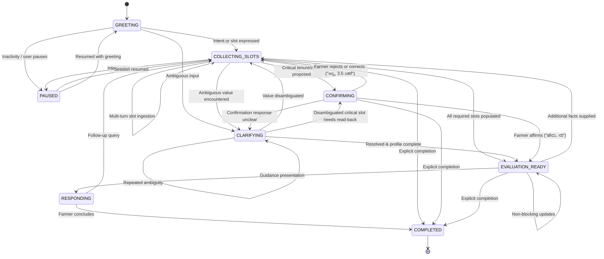

# Milestone M3 — Conversational Intelligence & Persistent Memory

## 1. Overview

Milestone M3 implements a persistent, natural, multi-turn Kannada conversation engine for Krishi Mitra:
1. **Deterministic Dialogue State Machine (M3.2):** Strict state transition graph (`GREETING`, `COLLECTING_SLOTS`, `CLARIFYING`, `CONFIRMING`, `EVALUATION_READY`, `RESPONDING`, `COMPLETED`, `PAUSED`) rejecting unauthorized state jumps.
2. **Intent-Dependent Slot Registry (M3.3):** Specialized slot requirement sets for distinct farmer intents (`INCOME_SUPPORT`, `CROP_INSURANCE`, `MICRO_IRRIGATION`, `AGRICULTURAL_EQUIPMENT`, `SOIL_IMPROVEMENT`, `FIND_SCHEMES`) ensuring farmers are not interrogated for irrelevant details.
3. **Slot Confirmation & Spoken Correction Routing (M3.4):** Affirmation ("ಹೌದು", "ಸರಿ", "ಖಚಿತ") and rejection ("ಇಲ್ಲ", "ತಪ್ಪು") semantics, routing natural spoken corrections ("ನಾಲ್ಕು ಎಕರೆ ಅಲ್ಲ, ಮೂರೂವರೆ ಎಕರೆ") into `AgriculturalProfileAssembler`, and recording previous-value audit trails.
4. **Persistent Conversation Memory & Concurrency (M3.5):** PostgreSQL persistence of conversation state, turns (`ConversationTurn`), slots with provenance (`ConversationSlot`), farmer agricultural profile (`FarmerProfile`), non-sensitive audit events (`AuditEvent`), and version-based optimistic concurrency control.
5. **Conversation Resumption & Replay Protection (M3.1 & M3.6):** Preserves conversation state across browser refresh, network disconnection, and backend restart. Enforces BOLA (Broken Object Level Authorization) ownership isolation.
6. **Conversational Kannada Response Generation (M3.7):** Single-slot conversational questioning, clarification prompts, and read-back confirmations in plain native Kannada with resilient TTS fallback. Non-negotiable invariant: **Zero scheme eligibility decisions in LLM or dialogue manager.**

---

## 2. Dialogue State Machine



### Transition Constraints
- State transitions are strictly validated by `DialogueStateMachine.transition(from_state, to_state)`.
- Illegal jumps (e.g. `GREETING` $\rightarrow$ `EVALUATION_READY` or transitions out of terminal `COMPLETED`) raise `InvalidStateTransitionError` (HTTP 400).
- An unrestricted LLM agent cannot override or dictate state transitions.

---

## 3. Intent-Dependent Slot Registry

Instead of demanding all fields from every farmer, `IntentSlotRegistry` declares tailored requirements per intent:

| Intent | Required Slots | Optional Slots | Priority Question Order |
|---|---|---|---|
| `INCOME_SUPPORT` | `district`, `land_ownership`, `land_area` | `crop` | `district` $\rightarrow$ `land_ownership` $\rightarrow$ `land_area` |
| `CROP_INSURANCE` | `district`, `crop`, `season` | `land_area`, `land_ownership` | `district` $\rightarrow$ `crop` $\rightarrow$ `season` $\rightarrow$ `land_area` |
| `MICRO_IRRIGATION` | `district`, `irrigation`, `land_area`, `land_ownership` | `crop` | `district` $\rightarrow$ `irrigation` $\rightarrow$ `land_area` $\rightarrow$ `land_ownership` |
| `AGRICULTURAL_EQUIPMENT` | `district`, `equipment`, `land_area` | `land_ownership`, `crop` | `district` $\rightarrow$ `equipment` $\rightarrow$ `land_area` $\rightarrow$ `land_ownership` |
| `SOIL_IMPROVEMENT` | `district`, `soil_improvement` | `crop`, `land_area` | `district` $\rightarrow$ `soil_improvement` $\rightarrow$ `crop` |
| `FIND_SCHEMES` | `district`, `crop` | `land_area`, `land_ownership`, `irrigation` | `district` $\rightarrow$ `crop` $\rightarrow$ `land_area` $\rightarrow$ `land_ownership` |
| `EXPLAIN_SCHEME` / `HELP` | *None (Immediate guidance)* | `district`, `crop` | `district` |

---

## 4. Multi-Turn Conversation Example (Native Kannada)

### Turn 1: Farmer Greeting & District Declaration
- **Farmer:** `"ನಮಸ್ಕಾರ, ನಾನು ಧಾರವಾಡ ಜಿಲ್ಲೆಯ ರೈತ. ಸಹಾಯಧನದ ಬಗ್ಗೆ ತಿಳಿಸಿ."`
- **NLU Intent:** `FIND_SCHEMES` / `INCOME_SUPPORT`
- **Extracted Slots:** `district = DHARWAD`
- **Dialogue State:** `COLLECTING_SLOTS`
- **Assistant Response:** `"ನೀವು ಯಾವ ಬೆಳೆ ಬೆಳೆಯುತ್ತಿದ್ದೀರಿ ಅಥವಾ ಬೆಳೆಯಲು ಯೋಜಿಸಿದ್ದೀರಿ?"`

### Turn 2: Farmer Crop & Initial Land Measurement
- **Farmer:** `"ನನ್ನ ಬಳಿ ನಾಲ್ಕು ಎಕರೆ ಜಮೀನಿದೆ, ಜೋಳ ಬೆಳೆಯುತ್ತಿದ್ದೇನೆ."`
- **Extracted Slots:** `primary_crop = SORGHUM`, `land_area = 4.0000 acres`
- **Dialogue State:** `COLLECTING_SLOTS`
- **Assistant Response:** `"ಜಮೀನು ನಿಮ್ಮ ಸ್ವಂತ ಹೆಸರಿನಲ್ಲಿದೆಯೇ, ಜಂಟಿ ಖಾತೆಯಲ್ಲಿದೆಯೇ ಅಥವಾ ಗೇಣಿ/ಗುತ್ತಿಗೆಗೆ ಮಾಡುತ್ತಿದ್ದೀರಾ?"`

### Turn 3: Spoken Correction (FR-009)
- **Farmer:** `"ನಾಲ್ಕು ಎಕರೆ ಅಲ್ಲ, ಮೂರೂವರೆ ಎಕರೆ."`
- **Correction Parsing:** `negated_part = "ನಾಲ್ಕು ಎಕರೆ"`, `corrected_part = "ಮೂರೂವರೆ ಎಕರೆ"`
- **Profile Action:** `land_area` revised to `3.5000` acres. `SlotAuditRecord` appended with UTC timestamp.
- **Assistant Response:** `"ಜಮೀನು ನಿಮ್ಮ ಸ್ವಂತ ಹೆಸರಿನಲ್ಲಿದೆಯೇ, ಜಂಟಿ ಖಾತೆಯಲ್ಲಿದೆಯೇ ಅಥವಾ ಗೇಣಿ/ಗುತ್ತಿಗೆಗೆ ಮಾಡುತ್ತಿದ್ದೀರಾ?"`

### Turn 4: Land Tenure Declaration
- **Farmer:** `"ಇದು ನನ್ನ ಸ್ವಂತ ಜಮೀನು."`
- **Classified Tenure:** `OwnershipType.OWNER` (`requires_confirmation=True`, `assertion=USER_STATED`)
- **Dialogue State:** `CONFIRMING`
- **Assistant Response:** `"ನೀವು ಜಮೀನಿನ ಮಾಲೀಕತ್ವ 'ಸ್ವಂತ ಜಮೀನು' ಎಂದು ತಿಳಿಸಿದ್ದೀರಿ. ಇದು ಸರಿಯೇ?"`

### Turn 5: Confirmation Affirmation
- **Farmer:** `"ಹೌದು, ಸರಿಯಾಗಿದೆ."`
- **Confirmation Analysis:** `ConfirmationDecision.AFFIRMED`
- **Profile Action:** Tenure marked `USER_CONFIRMED`. All critical slots satisfied with zero conflicts.
- **Dialogue State:** `EVALUATION_READY`
- **Assistant Response:** `"ಧನ್ಯವಾದಗಳು. ನಿಮ್ಮ ಎಲ್ಲ ಅಗತ್ಯ ಕೃಷಿ ವಿವರಗಳನ್ನು ಸಂಗ್ರಹಿಸಲಾಗಿದೆ. ನಿಮ್ಮ ಯೋಜನೆಗಳ ಅರ್ಹತೆ ಪರಿಶೀಲನೆಗೆ ವಿವರಗಳು ಸಿದ್ಧವಾಗಿವೆ."`

---

## 5. Persistent Memory & Concurrency Control

### Database Schema Alignment
- `conversations`: Primary session record tracking `farmer_id`, `state`, `status`, `summary`, `version`, and `last_activity_at`.
- `conversation_turns`: Chronological turns tracking `turn_number`, `input_mode` (`VOICE` or `TEXT`), `transcript_text`, `assistant_text`, `asr_model_version`, and `tts_model_version`.
- `conversation_slots`: Structured slot history tracking `slot_key`, `canonical_value`, `slot_status`, `provenance` (`USER_STATED`, `USER_CONFIRMED`), and incremental `slot_version`.
- `farmer_profiles`: Aggregated agricultural facts in `profile_data` (`JSONB` / Portable JSON).
- `audit_events`: Immutable security and lifecycle events.

### Concurrency Protection (Optimistic Locking)
Simultaneous turn requests against the same conversation are protected via row versioning:
$$\text{UPDATE conversations SET version = version + 1 WHERE id = :id AND version = :current\_version}$$
If another turn advances the version concurrently, `rowcount == 0` triggers an `OptimisticLockError` (HTTP 409 `CONCURRENCY_CONFLICT`), prompting the client to retry with the latest committed conversation state.

### BOLA Farmer Ownership Isolation
Every endpoint verifies `conversation.farmer_id == authenticated_farmer_id`. Attempts by unauthorized actors to read, submit turns to, or complete another farmer's session raise `AuthorizationError` (HTTP 403 `FORBIDDEN`).

---

## 6. API Reference

All endpoints are hosted under `/api/v1/conversations`:

| Method | Endpoint | Description | Status Code |
|---|---|---|---|
| `POST` | `/api/v1/conversations` | Initialize a new conversation session | 201 Created |
| `GET` | `/api/v1/conversations` | List authenticated farmer's conversations | 200 OK |
| `GET` | `/api/v1/conversations/active` | Retrieve the active conversation session | 200 OK |
| `GET` | `/api/v1/conversations/{id}` | Retrieve conversation metadata, profile & missing slots | 200 OK |
| `POST` | `/api/v1/conversations/{id}/turns/voice` | Submit audio turn (`multipart/form-data`) | 200 OK |
| `POST` | `/api/v1/conversations/{id}/turns/text` | Submit text turn (`application/json`) | 200 OK |
| `GET` | `/api/v1/conversations/{id}/turns` | Retrieve bounded chronological turn history | 200 OK |
| `POST` | `/api/v1/conversations/{id}/resume` | Resume a paused conversation | 200 OK |
| `POST` | `/api/v1/conversations/{id}/complete` | Conclude and complete a conversation | 200 OK |

---

## 7. Verification & Test Metrics

### Test Suite Summary
```text
======================= 142 passed in 15.81s =======================
Coverage: 87% (2577 statements, 345 missed)
```

| Component | Coverage | Status |
|---|---|---|
| `app/core/dialogue/state_machine.py` | 100% | PASSED |
| `app/core/dialogue/confirmation.py` | 92% | PASSED |
| `app/core/dialogue/intent_registry.py` | 74% | PASSED |
| `app/core/dialogue/prompts.py` | 76% | PASSED |
| `app/services/conversation_service.py` | 83% | PASSED |
| `app/api/v1/conversations.py` | 81% | PASSED |
| `app/core/exceptions.py` | 96% | PASSED |
| `app/schemas/conversation.py` | 100% | PASSED |

### Security & Fault Tolerance Tests
- **BOLA Protection:** Verified cross-farmer access denial in `test_farmer_ownership_isolation`.
- **Concurrency Conflicts:** Verified HTTP 409 rejection in `test_optimistic_concurrency_conflict`.
- **Completed Session Guard:** Verified HTTP 410 rejection on turn submission to closed sessions.
- **TTS Failure Degradation:** Verified text turn succeeds with `speech_available=False` when synthesizer is unreachable.
