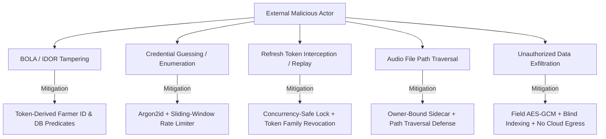

# M7 Security Review & Threat Mitigation Architecture

**Project:** Krishi Mitra (ಕೃಷಿ ಮಿತ್ರ)  
**Milestone:** M7 — System Validation, Production Deployment & Pilot Readiness  
**Document Classification:** Confidential — Platform Security Review  
**Date:** October 2026  

---

## 1. Security Architecture Principles

Krishi Mitra enforces a strict, defense-in-depth security model tailored to protect vulnerable rural agricultural users while complying with India's **Digital Personal Data Protection (DPDP) Act, 2023**.

### Core Architecture Axioms:
1. **Pure `FARMER` Role:** The only user-facing identity role is `FARMER`. Public admin, faculty, or elevated endpoints are strictly forbidden.
2. **Token-Derived Identity:** Farmer identity is derived exclusively from a validated Bearer JWT access token. Headers such as `x-farmer-id`, URL query parameters, or request body IDs are never trusted for authorization.
3. **Cryptographic Segmentation:** Identity lookup uses deterministic HMAC-SHA256 blind indexing, while sensitive personal data (e.g., telephone numbers) is encrypted at rest using AES-256-GCM.
4. **Air-Gapped Speech & LLM Execution:** External cloud LLM, ASR, and TTS services are prohibited. Speech and NLU pipelines execute entirely on isolated local infrastructure with zero network egress.
5. **Zero Persistent Audio by Default:** Farmer audio recordings are processed in memory and written only to an ephemeral directory with strict 15-minute TTL and automated secure deletion.

---

## 2. Threat Modeling & Attack Surface Review



---

## 3. Detailed Security Controls Implemented (M7.1)

### 3.1 Concurrency-Safe Refresh Token Rotation
In unstable rural network environments (2G/3G networks), mobile clients frequently re-transmit HTTP requests when acknowledgments are delayed. A naive single-use refresh token implementation would trigger false-positive replay revocations.

**Implementation (`app/core/security/revocation.py`):**
1. **In-Flight Coordination Lock:** When `/api/v1/auth/refresh` receives a token, it invokes `acquire_rotation_lock(old_token)`.
2. **Result Sharing:** If a concurrent request with the identical token arrives while rotation is executing, it waits on the lock and receives the *same newly generated successor token pair* via `consume_concurrent_result()`.
3. **Sequential Replay Punishment:** Once the rotation window closes, any subsequent attempt to present the consumed refresh token triggers immediate **Token Family Revocation**, revoking all active sessions for that farmer.

### 3.2 Immediate Access Token Revocation Semantics
Standard stateless JWT tokens remain valid until expiration. Krishi Mitra resolves this with dual-layer revocation:
1. **JTI Denylist:** Upon logout, the unique JWT ID (`jti`) is added to `TokenRevocationStore` (backed by Redis or synchronized memory) with TTL matching the token's remaining lifespan.
2. **Epoch Invalidation:** When a password changes or an account is deleted, `tokens_revoked_before` on the `Farmer` model is updated to `datetime.now(timezone.utc)`. Every authenticated request verifies that `token["iat"] >= farmer.tokens_revoked_before`.

### 3.3 Distributed Sliding-Window Rate Limiting
To prevent denial-of-service, brute force enumeration, and LLM exhaustion:
- **Rate Limit Zones:**
  - `/api/v1/auth/`: 10 requests / minute per IP (burst 5).
  - General API routes: 60 requests / minute per IP (burst 10).
  - Voice turns: 20 requests / minute per farmer.
- **Backend Architecture:** `app/core/security/rate_limiter.py` uses Redis sorted sets (`ZSET`) when `REDIS_URL` is configured, maintaining millisecond-accurate sliding windows across multiple Uvicorn worker processes. Falls back to a thread-safe in-memory sliding window when Redis is unavailable.

### 3.4 Key Separation & Multi-Key Rotation Fallback
- `APP_SECRET_KEY`: Signs and validates JWT access tokens.
- `BLIND_INDEX_KEY`: Salts HMAC-SHA256 blind indexes for exact-match phone number lookups.
- `ENCRYPTION_KEY`: Master 256-bit key for AES-GCM field encryption.
- `ENCRYPTION_KEY_PREVIOUS`: Secondary fallback key enabling zero-downtime key rotation. Decryption automatically attempts the primary key, falls back to the previous key, and logs an audit warning.

### 3.5 BOLA / IDOR Defense
Every database query for farmer-owned assets (conversations, agricultural profiles, turns, scheme recommendations, audio files) enforces an explicit database predicate:
```sql
SELECT * FROM conversations WHERE id = :conversation_id AND farmer_id = :authenticated_farmer_id;
```
If an attacker manipulates the URL or payload to target another farmer's UUID, the query yields `None` and raises a generic `404 Not Found` (preventing ID enumeration).

### 3.6 Ephemeral Audio Storage & Sidecar Validation
- Uploaded voice recordings and generated TTS responses are written to `AUDIO_TEMP_DIR` with random UUID filenames.
- A metadata sidecar (`.meta.json`) securely stores:
  - `owner_farmer_id`: Authenticated farmer UUID.
  - `expires_at`: ISO UTC timestamp (15 minutes from creation).
- When `/api/v1/voice/audio/{id}` is queried, the server verifies that `current_farmer.id == meta.owner_farmer_id` and that the file has not expired.
- **Path Traversal Defense:** Filenames are strictly validated against UUID syntax; directory traversal sequences (`../`, `/`, `\`) are immediately rejected.

---

## 4. DPDP Act 2023 Compliance & Privacy Architecture

| DPDP Act Requirement | Krishi Mitra Implementation | Verification Evidence |
|---|---|---|
| **Notice & Informed Consent (Sec 5 & 6)** | Consent record captured at registration with timestamp, IP, language, and explicit notice displayed in Kannada. | Verified via `app/models/farmer.py::ConsentRecord` and Journey A tests |
| **Right to Access & Portability (Sec 11)** | `GET /api/v1/privacy/export` returns a complete JSON bundle of farmer records, profiles, conversations, and consent history. | Verified via `tests/integration/test_e2e_farmer_journeys.py::test_journey_e` |
| **Right to Erasure (Sec 12)** | `POST /api/v1/privacy/delete` wipes farmer credentials, conversations, profiles, and audio recordings. | Verified via `tests/integration/test_e2e_farmer_journeys.py::test_journey_e` |
| **Statutory Retention Exception (Sec 8)** | Recommendation runs are retained for regulatory audit but decoupled (`conversation_id` set to NULL, profile redacted of PII). | Verified in `app/services/privacy_service.py` |
| **Data Minimization & Storage Limitation** | Temporary voice audio strictly purged after 15 minutes. Passwords hashed using memory-hard Argon2id. | Verified in `EphemeralAudioStore.cleanup_expired()` |

---

## 5. OWASP ASVS Top 10 Verification Checklist

| OWASP Risk Category | Status | Krishi Mitra Defensive Implementation |
|---|---|---|
| **A01: Broken Access Control** | **PASS** | Strict token-derived identity, BOLA database filtering, owner-bound audio sidecars. |
| **A02: Cryptographic Failures** | **PASS** | AES-256-GCM encryption, HMAC-SHA256 blind indexing, Argon2id password hashing, separate keys with rotation fallback. |
| **A03: Injection** | **PASS** | SQLAlchemy parameterized queries across 100% of routes; zero raw SQL string concatenation. Pydantic input validation. |
| **A04: Insecure Design** | **PASS** | Deterministic Python scheme engine (no LLM eligibility hallucination); explicit dialogue state transition graph. |
| **A05: Security Misconfiguration** | **PASS** | Public OpenAPI docs disabled in production; OWASP HTTP headers (HSTS, CSP, X-Frame-Options, X-Content-Type-Options) enforced. |
| **A06: Vulnerable & Outdated Components**| **PASS** | Automated dependency audit; pinned production packages in `requirements.txt` and `package-lock.json`. |
| **A07: Identification & Auth Failures** | **PASS** | Concurrency-safe refresh rotation, token family revocation, JTI denylist, lockout on 5 consecutive failures. |
| **A08: Software & Data Integrity** | **PASS** | Backup SHA-256 checksums, manifest cryptographic fingerprints, frozen lockfiles (`npm ci`). |
| **A09: Security Logging & Monitoring** | **PASS** | Correlation request ID (`X-Correlation-ID`), structured logging, exclusion of passwords, tokens, and audio from logs. |
| **A10: Server-Side Request Forgery (SSRF)**| **PASS** | Local Ollama communication bound to `127.0.0.1:11434`; no user-controlled outbound URL fetching. |
