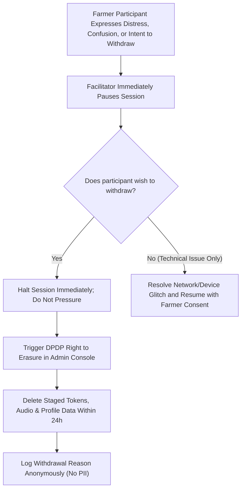

# Krishi Mitra — Milestone M8: Real-World Farmer Field Trial Evidence Protocol

**Document Status:** Formal Research & Operations Protocol (SOP)  
**Evidence Classification:** `DOCUMENTED_PROCEDURE` (Audit protocol; zero participant claims)  
**Authorizing Authority:** CTO & Field Engineering Operations  
**Governing Standard:** Digital Personal Data Protection (DPDP) Act, 2023 | ISO/IEC 25010 Software Quality  
**Target Pilot Scope:** Supervised Micro-Pilot Cohort (N = 10–15 Consented Farmers)  

---

> [!IMPORTANT]
> **PURPOSE AND RIGOR STANDARD:**  
> This protocol specifies the mandatory operating rules, technical configurations, data minimization controls, and auditable procedures for conducting the first real-world farmer field evaluation of Krishi Mitra.  
> 
> **Core Operating Rules:**
> 1. No automated simulation result may be cited as real field evidence.
> 2. No test session may proceed without explicit, revocable, written/witnessed informed consent.
> 3. Facilitators must NOT touch the device or speak for participants during evaluation tasks.
> 4. All failures, timeouts, retries, and task abandonments must be recorded without alteration.
> 5. No raw audio, unhashed phone numbers, or participant PII shall be committed to public git artifacts.

---

## 1. Participant Recruitment & Eligibility Criteria

Participants must be recruited from operational agricultural communities across Karnataka under transparent, non-coercive criteria:

### 1.1 Inclusion Criteria:
1. **Active Cultivator:** Currently cultivating land (either as owner, joint family titleholder, or registered tenant) within the selected trial district/taluk.
2. **Native Kannada Speaker:** Fluent in conversational Kannada matching the local regional dialect.
3. **Age:** 18 years or older.
4. **Literacy Independence:** Both literate and non-literate/minimally literate farmers are eligible and encouraged to participate to evaluate voice-first accessibility.
5. **Crop Profile:** Cultivating at least one major state-supported crop (e.g. Paddy, Sorghum, Finger Millet, Pigeon Pea, Cotton, Sugarcane, Arecanut, Groundnut).

### 1.2 Exclusion Criteria:
1. Commercial software testers, agtech vendor representatives, or government administrative personnel.
2. Individuals under 18 years of age.
3. Persons refusing or unable to provide voluntary, informed consent.
4. Individuals receiving coercive or conditional incentives tied to specific survey outcomes. (Modest compensation for travel and time, e.g. ₹500 travel allowance, is permitted, but must not be contingent on positive feedback).

---

## 2. Informed Consent & Participant Rights (DPDP Act, 2023)

1. **Informed Consent Delivery:**
   - Consent notices must be provided in written native Kannada and read aloud verbatim by the independent observer.
   - The notice must clearly describe that participation is voluntary, that refusing to participate carries zero penalty or impact on government scheme eligibility, and that participants may withdraw at any time.
   - Consent is captured via physical signature or witnessed thumbprint, referenced by a unique Consent Record ID: `CR-2026-[DISTRICT]-[XXX]`.
2. **Revocation & Right to Erasure:**
   - If a participant revokes consent during or after the session, all session logs, audio files, and survey responses must be permanently expunged within 24 hours per DPDP Act Section 12.
3. **Data Minimization:**
   - Phone numbers are immediately hashed (`HMAC-SHA256`) using the staging secret salt before database entry.
   - Personal names and land survey plot numbers are never collected or stored in session transcripts.

---

## 3. Real Device & Rural Network Deployment Environments

Simulated desktop browsers and local localhost loops are prohibited for this protocol. Trials must be conducted under real rural environmental conditions:

```
+-----------------------------------------------------------------------------------+
|                        PHYSICAL PILOT TRIAL ENVIRONMENT                           |
+-----------------------------------------------------------------------------------+
| Devices:          Low-to-mid range Android smartphones (Android 10 - 14)          |
|                   Examples: Redmi 10/12, Samsung Galaxy M14, Realme C53          |
| Audio Modes:      1. Loudspeaker (Hands-free, simulated field ambient noise)      |
|                   2. Phone earpiece mode                                          |
| Network Modes:    Live commercial 4G LTE and edge 2G/3G rural cellular networks   |
|                   (Airtel / Jio / BSNL) in field locations (Signal: -95 to -115 dBm)|
| Ambient Context:  Outdoor daylight (sunlight glare test) and village community hall|
| Host Endpoint:    Live Staging Infrastructure (PostgreSQL 16 + Redis 7 + HTTPS)    |
+-----------------------------------------------------------------------------------+
```

---

## 4. Production Voice AI Pipeline Integration

Mock components (`MockSpeechRecognizer`, `MockSpeechSynthesizer`, deterministic rule mocks) are strictly forbidden in this real pilot:

1. **Speech Recognition (ASR):**
   - Real Kannada speech audio is captured via the browser Web Audio API / MediaRecorder ($16\,\text{kHz}$, 16-bit PCM Mono WAV).
   - Audio is streamed over TLS to the production **IndicConformer / Bhashini Kannada ASR** pipeline.
   - Word Error Rate (WER) and Character Error Rate (CER) are computed against ground-truth human transcriptions created post-session.
2. **Speech Synthesis (TTS):**
   - Assistant responses are rendered through the production **AI4Bharat Indic-TTS / Bhashini Kannada** model.
   - Synthesized audio streams directly to the mobile device for real-time playback.
3. **Ephemeral Audio Storage & TTL:**
   - Audio payloads are held in staging audio storage with a strict 3600s (1-hour) TTL.
   - Permanent audio retention is permitted only for consented acoustic analysis in an encrypted offline storage silo accessible only to authorized ML research personnel.

---

## 5. Participant-Led Evaluation Tasks & Observer Guidelines

To ensure ecological validity and eliminate facilitator bias:
- **Zero Facilitator Intervention:** Facilitators must NEVER touch the smartphone screen after opening the pilot URL, and must NEVER dictate or speak on the farmer's behalf.
- **Natural Language Prompts:** Farmers are given real-world goals in Kannada (e.g. *"Tell the assistant about your land and ask what government schemes apply"*), rather than scripted text to read.

### Standardized Task Set:

```markdown
Task 1: Voice Initiation & Greeting
  - Action: Farmer taps microphone button and speaks an initial greeting in their natural regional dialect.
  - Success Metric: Assistant responds with a synthesized Kannada greeting within 3.0s.

Task 2: Agricultural Fact Entry (Multi-Slot Profile)
  - Action: Farmer naturally speaks their location (district/taluk), landholding area (acres/guntas), and primary crop.
  - Success Metric: System accurately canonicalizes location, crop, and acreage without misclassification.

Task 3: Spoken Fact Correction
  - Action: Farmer notices an error or changes a detail (e.g. *"Actually, I have 3 acres, not 2"*).
  - Success Metric: System updates the target slot, retains previously confirmed slots, and confirms the change.

Task 4: Scheme Explanation & Document Guidance
  - Action: Assistant plays audio explanation of recommended schemes and required application documents.
  - Success Metric: Farmer can explain what documents (e.g. Aadhaar, Pahani/RTC) are needed in their own words.

Task 5: Official Verification & Disclaimer Comprehension
  - Action: Farmer evaluates whether the recommendation represents guaranteed money or requires official survey.
  - Success Metric: Farmer explicitly acknowledges that official revenue/agriculture department survey is mandatory.
```

---

## 6. Comprehensive Failure Recording & Metric Logging

Facilitators and independent observers must document all interaction anomalies using the following standardized failure taxonomy:

| Failure Code | Category | Definition | Recovery Action |
| :--- | :--- | :--- | :--- |
| `ERR_ASR_RETRY` | Acoustic Failure | ASR transcript failed to recognize utterance; system prompted: *"ದಯವಿಟ್ಟು ಮತ್ತೊಮ್ಮೆ ಸ್ಪಷ್ಟವಾಗಿ ಹೇಳಿ"*. | Single repeat attempt allowed. |
| `ERR_NET_TIMEOUT`| Network Latency | Cellular packet loss caused request timeout (> 5.0s); PWA displayed offline retry banner. | Automatic client exponential backoff retry. |
| `ERR_SLOT_MISMATCH`| NLU Extraction | System extracted incorrect district, taluk, or crop from clear spoken utterance. | Logged as extraction error; prompt farmer for correction. |
| `ERR_TTS_FAIL` | Synthesis Failure | Audio playback stalled, degraded to fallback text response on device screen. | Logged as TTS degradation. |
| `ERR_USER_ABANDON`| Usability Drop | Participant expressed frustration, chose not to proceed, or handed back device before completing tasks. | Session recorded as ABANDONED; root cause logged. |

---

## 7. Scheme Recommendation Verification by Domain Experts

Before any pilot cohort results are certified:
1. **Independent Agronomic Audit:**
   - Every evaluated conversation trace must be reviewed by a panel consisting of:
     - 1 Agricultural Extension Officer (KVK / University of Agricultural Sciences, Bangalore/Dharwad).
     - 1 Revenue / Land Administration Specialist.
2. **Audit Checklist:**
   - Did the system accurately exclude tenant farmers from landowner-only schemes?
   - Were mandatory statutory caveats regarding crop loss cut-off dates correctly verbalized?
   - Were the required application routes (Grama One / Seva Sindhu / Bangalore One) accurately specified?
3. **Audit Receipt:**
   - Panel signs an auditable recommendation verification receipt with timestamp and professional credential ID.

---

## 8. Incident Response, Safety & Withdrawal Protocol



---

## 9. Secure Evidence Storage & Repository Hygiene

To safeguard farmer privacy and adhere to government data governance standards:
- **No Public PII:** Under no circumstances shall identifiable farmer names, raw audio recordings, photos, phone numbers, or signed consent documents be committed to public GitHub repositories or unencrypted cloud buckets.
- **Evidence Vault Architecture:**
  - Raw session audio and signed consent scans are archived in an access-restricted, AES-256 encrypted object storage bucket with role-based IAM (accessible only to the Lead Researcher and Compliance Officer).
  - Public repository commits are restricted to:
    1. Anonymized statistical metric summaries (e.g. aggregate task completion rate, average latency).
    2. De-identified acoustic benchmark metrics (WER/CER by dialect cluster).
    3. Formal validation checklists and procedural audit reports.

---

## 10. Individual Session Record Schema (Template)

Every conducted field test must generate a structured session receipt formatted as follows:

```json
{
  "session_id": "KM-M8-PILOT-2026-DWD-01",
  "software_version": "1.0.0",
  "commit_sha": "2213d11eceecaaa7ec4ed14e24766de8833c36a0",
  "execution_timestamp": "2026-11-15T10:30:00Z",
  "location": {
    "district": "DHARWAD",
    "taluk": "NAVALGUND",
    "village_cluster": "Navalgund-Rural",
    "agro_climatic_zone": "North Karnataka Dryland"
  },
  "device": {
    "model": "Redmi 12",
    "os_version": "Android 13",
    "browser": "Chrome Mobile 122.0",
    "network_type": "4G LTE (Airtel)",
    "signal_strength_dbm": -102
  },
  "facilitator_id": "FAC-KN-04",
  "observer_id": "OBS-KN-01",
  "consent_record_ref": "CR-2026-DWD-001",
  "task_outcomes": {
    "T1_greeting": "PASSED",
    "T2_fact_input": "PASSED",
    "T3_correction": "PASSED",
    "T4_scheme_comprehension": "PASSED",
    "T5_caveat_acknowledgment": "PASSED"
  },
  "failures_encountered": [],
  "session_duration_seconds": 342,
  "farmer_likert_scores": {
    "Q1_clarity": 5,
    "Q2_accuracy": 4,
    "Q3_caveat_trust": 5,
    "Q4_usability": 4,
    "Q5_adoption_intent": 5
  },
  "domain_expert_audit": {
    "expert_name": "[AUDITED BY KVK SCIENTIST]",
    "status": "APPROVED",
    "notes": "Accurate PM-KISAN guidance and proper tenant routing."
  },
  "evidence_storage_ref": "vault://evidence/m8-pilot/dwd/session-001.enc"
}
```
