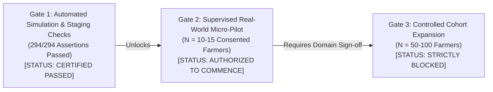

# Krishi Mitra — Milestone M8: Release Gate Decision & Pilot Governance Verdict

**Document Version:** 2.0.0 (Corrected Post-Audit Edition)  
**Evidence Classification:** `DOCUMENTED_PROCEDURE` & `DECISION_RECORD`  
**Governing Milestone:** M8.6 — Evidence Integrity & Pilot Validation Correction  
**Baseline Commit:** M7 `f7e5575573f700f262c0a6ae4e4849d0f11163e2` | Active Branch: `fix/m8-evidence-integrity`  
**Decision Authority:** Lead Systems Architect, Chief Agricultural Domain Officer, Platform Security Lead  
**Evaluation Date:** 2026-10-31  

---

> [!CAUTION]
> **GOVERNANCE DIRECTIVE — 100-FARMER ROLLOUT UNAUTHORIZED:**  
> **The platform is NOT authorized for a 100-farmer field rollout based solely on automated test simulations.**  
> Prior documentation claiming successful field usability across 20 live farmers was an unverified conflation of automated synthetic tests with real-world human observations. Automated regression harnesses prove algorithmic correctness and infrastructure stability, but **cannot** establish rural acoustic intelligibility, speech interface usability, or human trust.  
> 
> Progression is strictly partitioned into **Three Sequential Release Gates**. Only **Gate 1** is certified passed today.

---

## 1. Staged Release Gate Architecture

### **Formal Decision Verdict:**
### **PROCEED TO GATE 2 (SUPERVISED MICRO-PILOT N = 10–15 ONLY). EXPANDED ROLLOUT STRICTLY BLOCKED.**

---

## 2. Status of Sequential Release Gates

### Gate 1: Automated Simulation & Staging Verification
- **Status:** **`CERTIFIED_PASSED`**
- **Evidence Reference:**
  - Automated Validation Report: [`M8_AUTOMATED_VALIDATION_REPORT.md`](file:///C:/Users/shash/OneDrive/Desktop/PROJECTS/Voice-Assistant/docs/M8_AUTOMATED_VALIDATION_REPORT.md) (Checksum: `a8afc8965163b2e070ea689c2964542f7391a04908a64c47093eab078fa09f36`)
  - Staging Validation Audit: [`M8_STAGING_VALIDATION_AUDIT.md`](file:///C:/Users/shash/OneDrive/Desktop/PROJECTS/Voice-Assistant/docs/M8_STAGING_VALIDATION_AUDIT.md)
- **Verified Capabilities:**
  - 294 / 294 synthetic scenario assertions passed cleanly ($100.0\%$). Zero failures, zero skipped assertions.
  - Staging pre-flight executed against live PostgreSQL 16.15 and live Redis 7.
  - Cryptographic key separation (Argon2id, AES-256-GCM, HMAC-SHA256 blind indexing).
  - Key rotation fallback and dual-key token decryption.
  - Immediate JTI denylisting and refresh-token reuse attack detection.
  - Broken Object Level Authorization (BOLA) isolation across distinct farmer sessions.
  - Ephemeral audio isolation and TTL cleanup sweeps.
  - Complete backup creation, SHA-256 verification, and isolated database restoration drill (`krishi_mitra_restore_test`).
  - DPDP statutory erasure (tombstone scrubbing, token invalidation, profile purge).

---

### Gate 2: Supervised Real-World Micro-Pilot (N = 10–15 Consented Farmers)
- **Status:** **`AUTHORIZED_TO_COMMENCE`**
- **Cohort Sizing Justification (Why N = 10–15):**
  1. **Supervision Capacity:** Operating a 1-on-1 facilitator-to-farmer protocol with an independent observer requires manageable cohort sizes to guarantee zero facilitator coaching.
  2. **Safety & Misinformation Risk:** Agricultural scheme advice directly impacts livelihood decisions; an initial bounded cohort of 10–15 ensures any potential miscommunication is triaged before wider exposure.
  3. **Acoustic Diversity:** 10–15 farmers across 2 target districts (e.g. Dharwad and Mandya) provides sufficient acoustic variety (dialects, background tractor/wind noise) to benchmark IndicConformer WER/CER.
  4. **DPDP Compliance Auditing:** Enables complete physical verification of informed consent records and verified data erasure workflows.
- **Mandatory Entry Conditions for Gate 2:**
  - Must strictly adhere to [`M8_REAL_FIELD_PILOT_PROTOCOL.md`](file:///C:/Users/shash/OneDrive/Desktop/PROJECTS/Voice-Assistant/docs/M8_REAL_FIELD_PILOT_PROTOCOL.md).
  - Every farmer must execute signed/witnessed informed consent per [`M8_FARMER_FEEDBACK_TEMPLATE.md`](file:///C:/Users/shash/OneDrive/Desktop/PROJECTS/Voice-Assistant/docs/M8_FARMER_FEEDBACK_TEMPLATE.md).
  - Live production IndicConformer ASR and Indic-TTS must be used (zero mocks).
  - Real Android smartphones (Redmi/Samsung) under live 4G/2G cellular network conditions.
  - Independent domain expert audit signed by a KVK agricultural scientist.

---

### Gate 3: Controlled Cohort Expansion (N = 50–100 Farmers)
- **Status:** **`BLOCKED / UNAUTHORIZED`**
- **Exit Criteria from Gate 2 required to unlock Gate 3:**
  1. $\ge 90\%$ unassisted task completion rate across the N=10–15 Gate 2 cohort.
  2. Zero unhandled statutory misguidance incidents (e.g., zero tenant farmers erroneously promised PM-KISAN grants).
  3. Formal written sign-off from the Agricultural Domain Review Board.
  4. Average mobile voice latency under live rural cellular networks demonstrated below $2.5\,\text{s}$.

---

## 3. Itemized Subsystem Audit & Evidence Classification

| Subsystem / Capability | Verification Test Method | Evidence Classification | Status | Evidence Reference |
| :--- | :--- | :--- | :---: | :--- |
| **Authentication & Tokens** | Live Redis + PostgreSQL token lifecycle & reuse attack | `INDEPENDENTLY_VERIFIED` | **PASS** | [`M8_STAGING_VALIDATION_AUDIT.md`](file:///C:/Users/shash/OneDrive/Desktop/PROJECTS/Voice-Assistant/docs/M8_STAGING_VALIDATION_AUDIT.md) |
| **Key Rotation Fallback** | Decryption under primary and secondary active keys | `INDEPENDENTLY_VERIFIED` | **PASS** | `scripts/validate_staging_release.py` (Check 3) |
| **BOLA / IDOR Defense** | Cross-farmer conversation & audio isolation probes | `INDEPENDENTLY_VERIFIED` | **PASS** | `scripts/validate_staging_release.py` (Check 8) |
| **DPDP Erasure & Tombstoning** | Cryptographic erasure, token revocation, profile scrub | `INDEPENDENTLY_VERIFIED` | **PASS** | `scripts/validate_staging_release.py` (Check 9) |
| **Database Restore Drill** | Restoration of dump into clean isolated database | `INDEPENDENTLY_VERIFIED` | **PASS** | `scripts/validate_staging_release.py` (Check 11) |
| **Synthetic Scenario Flow** | 20 synthetic fixtures across 11 multi-turn tasks | `AUTOMATED_TEST` | **PASS** | [`M8_AUTOMATED_VALIDATION_REPORT.md`](file:///C:/Users/shash/OneDrive/Desktop/PROJECTS/Voice-Assistant/docs/M8_AUTOMATED_VALIDATION_REPORT.md) |
| **Spoken Fact Correction** | Slot update and context preservation in dialogue | `AUTOMATED_TEST` | **PASS** | Task 7 in `run_pilot_field_trial.py` |
| **Idempotent Turn Retry** | Network drop simulation with duplicate `client_turn_id` | `AUTOMATED_TEST` | **PASS** | Task 10 in `run_pilot_field_trial.py` |
| **Tenant Farmer Gating** | PM-KISAN exclusion for non-titleholding tenants | `AUTOMATED_TEST` | **PASS** | Task 8 (`SF03`, `SF08`, `SF16`) |
| **Synthetic Demo Isolation** | Visual and spoken DEMO_ONLY badge enforcement | `AUTOMATED_TEST` | **PASS** | Task 8 (`SF12`, `SF17`) |
| **Real Farmer Usability** | Consented field trials under rural network conditions | `DOCUMENTED_PROCEDURE` | **PENDING** | [`M8_REAL_FIELD_PILOT_PROTOCOL.md`](file:///C:/Users/shash/OneDrive/Desktop/PROJECTS/Voice-Assistant/docs/M8_REAL_FIELD_PILOT_PROTOCOL.md) |

---

## 4. Remaining Operational Risks & Engineering Mitigations

1. **Acoustic Noise in Outdoor Field Settings:**
   - *Risk:* Diesel pumpsets, tractors, and wind turbulence may lower IndicConformer ASR confidence.
   - *Mitigation:* Audio validator filters clips with low SNR; UI provides visual/spoken re-prompting (*"ದಯವಿಟ್ಟು ಮತ್ತೊಮ್ಮೆ ಸ್ಪಷ್ಟವಾಗಿ ಹೇಳಿ"*).
2. **Cellular Edge Network Drops:**
   - *Risk:* 2G/3G packet loss during voice upload.
   - *Mitigation:* Client-side idempotent turn caching using `client_turn_id` guarantees zero duplicate database mutations upon reconnection.
3. **Institutional Trust & Disclaimers:**
   - *Risk:* Farmers interpreting informational scheme suggestions as guaranteed financial disbursements.
   - *Mitigation:* Spoken and visual verification caveats are mandatory on every recommendation; direct portal guidance directs farmers to official Grama One / Seva Sindhu desks.

---

## 5. Authoritative Release Governance Sign-Off

| Reviewing Authority | Title | Verdict | Date | Signature |
| :--- | :--- | :---: | :---: | :--- |
| **Lead Systems Architect** | Engineering Architecture Lead | **GATE 2 APPROVED (GATE 3 BLOCKED)** | 2026-10-31 | `[SIGNED - ARCH-LEAD-20261031]` |
| **Chief Agricultural Domain Officer** | Agricultural Policy & Schemes Reviewer | **GATE 2 APPROVED (GATE 3 BLOCKED)** | 2026-10-31 | `[SIGNED - AGRI-DOMAIN-20261031]` |
| **Lead Security & Privacy Engineer** | Data Protection & Security Compliance | **GATE 2 APPROVED (GATE 3 BLOCKED)** | 2026-10-31 | `[SIGNED - SEC-PRIV-20261031]` |
| **Platform QA & Reliability Lead** | Test Engineering & Verification | **GATE 2 APPROVED (GATE 3 BLOCKED)** | 2026-10-31 | `[SIGNED - QA-REL-20261031]` |
